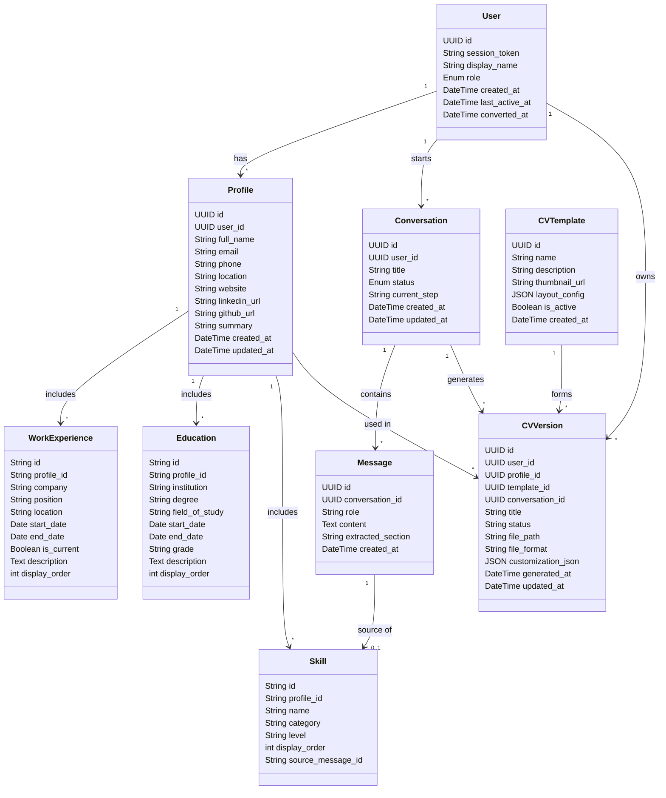

# Database Models and Schemas UML Diagram

Based on the entities defined in `backend/app/models` and their corresponding DTOs in `backend/app/schemas`, here is a comprehensive Entity-Relationship Class Diagram mapping out the application's core domain.

## Key Relationships
- **User** is the core entity that owns **Profiles**, **Conversations**, and **CVVersions**.
- **Profiles** contain detailed elements like **Educations**, **WorkExperiences**, and **Skills**.
- **Conversations** and **Messages** handle the LLM integration flow and interaction history.

> [!NOTE] 
> The `backend/app/shemas` directory reflects these underlying models via modular Base, Create, Update, and Output Pydantic schemas which validate data flowing into and out of these core tables.

> [!TIP]
> A small observation: the `cv_templates` file in `models` is missing its `.py` file extension, and some files in the `shemas` directory have commas instead of dots in their names (e.g. `user,py`). You might want to rename them for proper python resolution!
